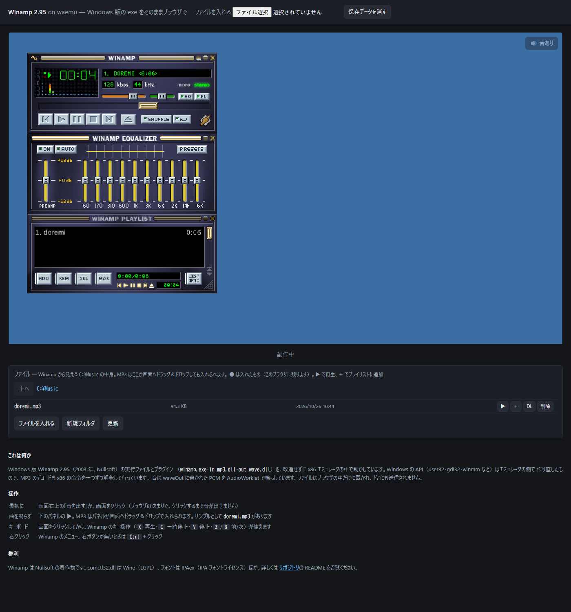
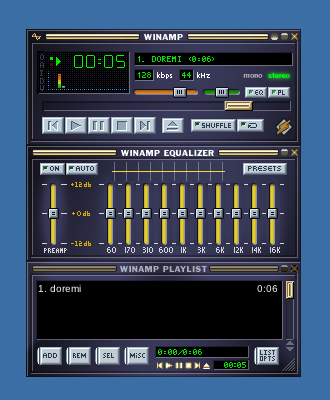

# winamp_emu_cpp

Windows 版 **Winamp 2.95**（2003 年、Nullsoft）を、改造せずにそのまま x86 エミュレータで動かし、
WASM にしてブラウザで鳴らすためのリポジトリです。

**▶ ブラウザで動かす: <https://yomei-o.github.io/winamp_emu_cpp/>**
（Chrome / Edge / Firefox。初回はサービスワーカーを入れるために一度だけ自動で再読み込みします。
音はブラウザの決まりで、画面か「音を出す」をクリックしてから出ます）



* エミュレータ（CPU・ローダ・kernel32）と Win32 GUI 層（user32・gdi32 など）は
  [jwcad_win_emu_cpp](https://github.com/yomei-o/jwcad_win_emu_cpp)（commit 55bdc8f）から取り込み、
  Winamp 用に足したもの。comctl32 は Wine 8.0 の comctl32.dll（LGPL）をゲストとして動かす
* `orig/winamp295.exe` は公式インストーラそのまま。中のファイルは `tools/prepare_winamp.py` が
  取り出す（NSIS を展開し、PE のエクスポート名・バージョン情報で名前を決める）
* 動かしているのは `winamp.exe`・`Plugins/in_mp3.dll`（MP3 デコーダ）・`Plugins/out_wave.dll`（waveOut 出力）。
  MP3 のデコードもエミュレートした x86 命令で行っている

## Winamp のために足したもの

* **スレッド**：Winamp はデコード・出力・GUI の 3 スレッドが同時に動く。待ち（Sleep・WaitForSingleObject・
  GetMessage）を命令数ではなく実時間で数え、GUI スレッドが待つ間やウィンドウプロシージャの中で待つ間は
  他のスレッドを走らせる（`Emulator::run_others_while`）。Stop ボタンでデコードスレッドの終わりを待つのが
  まさにこれ
* **winmm の waveOut**（`src/win32/winmm.cpp`）：書かれたバッファは、出力先が実際に鳴らし終えた時点で
  WHDR_DONE にしてイベントを立てる。ブラウザでは SharedArrayBuffer のリングに 16bit PCM を入れ、
  `audio-worklet.js` が鳴らした分だけ「再生済み」を進めるので、Winamp は鳴る速さで次を書く。
  音の出口が無いとき（ヘッドレス実行）は時計で再生したことにする
* **VC6 の MSVCRT**：`_except_handler3`（__try/__except）、`_ftol`・`_CIpow`、`_controlfp`、
  `operator new/delete`、データとして読まれる `_acmdln`・`_pctype`・`_adjust_fdiv` など
* x87 の FIADD〜FIDIVR m32、INI の Get/WritePrivateProfileStruct、枠を持たないスキン窓には
  DWM の枠と影を付けない、など

## ブラウザ版

エミュレータは Web Worker の中で動き、入力待ちは `Atomics.wait`。画面は ImageBitmap でページへ送る。
下のパネルが Winamp から見える `C:\Music`。MP3 を入れる（ボタンかドラッグ＆ドロップ）と IndexedDB に残り、
▶ で再生、＋ でプレイリストに追加。パネルからの指示は Winamp の IPC（WM_COPYDATA の IPC_PLAYFILE、
WM_USER の IPC_DELETE・IPC_STARTPLAY）として届けている。

```sh
sh tools/build_wasm.sh            # -> waemu.js / waemu.wasm / waemu.data（emsdk、/c/prog/emsdk/emsdk）
node tools/test_wasm.mjs          # node でヘッドレスに動かして tmp/wasm.png（WAEMU_OPEN=C:\Music\doremi.mp3 で再生）
node tools/web_test.mjs           # ヘッドレス Chrome で起動・▶・音が 44100 フレーム/秒で出ているか
```

デコードは手元の ARM64 ノート（Chrome）でほぼ実時間ちょうど（6 秒の曲を node で約 4 秒）。
遅いマシンでは音が途切れることがある。

## ネイティブ版

```sh
sh tools/build.sh                         # -> waemu.exe（w64devkit の g++、低優先度）
sh tools/run.sh 8 'C:\Music\doremi.mp3'   # ヘッドレスで 8 秒、tmp/shot.png
WAEMU_TRACE_WAVE=1 sh tools/run.sh ...    # waveOut の呼び出しを表示
```



`samples/doremi.mp3` はテスト用に作った音（ドミソド、`tools/make_test_mp3.py`）。

## 権利

* `orig/winamp295.exe` は Winamp 2.95 の配布物そのまま（Nullsoft）
* `fonts/` は IPAex フォント（IPA Font License）、BIZ UDGothic・Liberation・Carlito（SIL OFL）
* `dlls_dist/wine/comctl32.dll` は Wine（GNU LGPL 2.1 以降、`dlls_dist/wine/COPYING.LIB`）
* `src/third_party/libtera/` は libtera の kanji.c（BSD）
* `src/third_party/stb_truetype.h`・`stb_image_write.h` は stb（パブリックドメイン / MIT）
* それ以外のソースは MIT（`LICENSE`）
